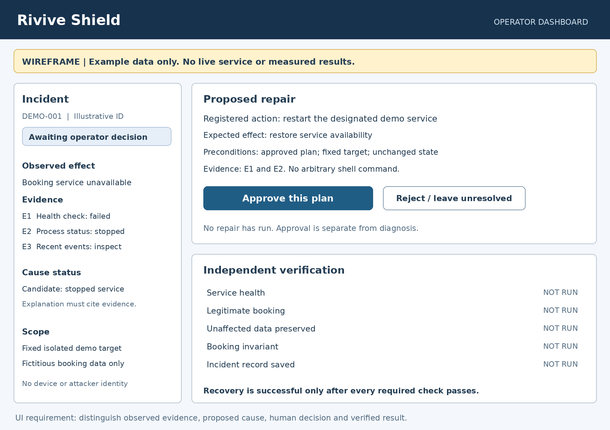
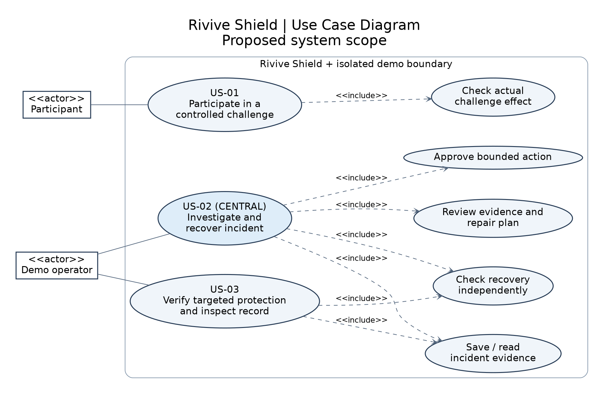
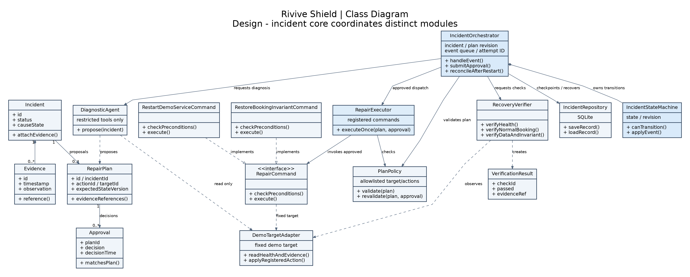
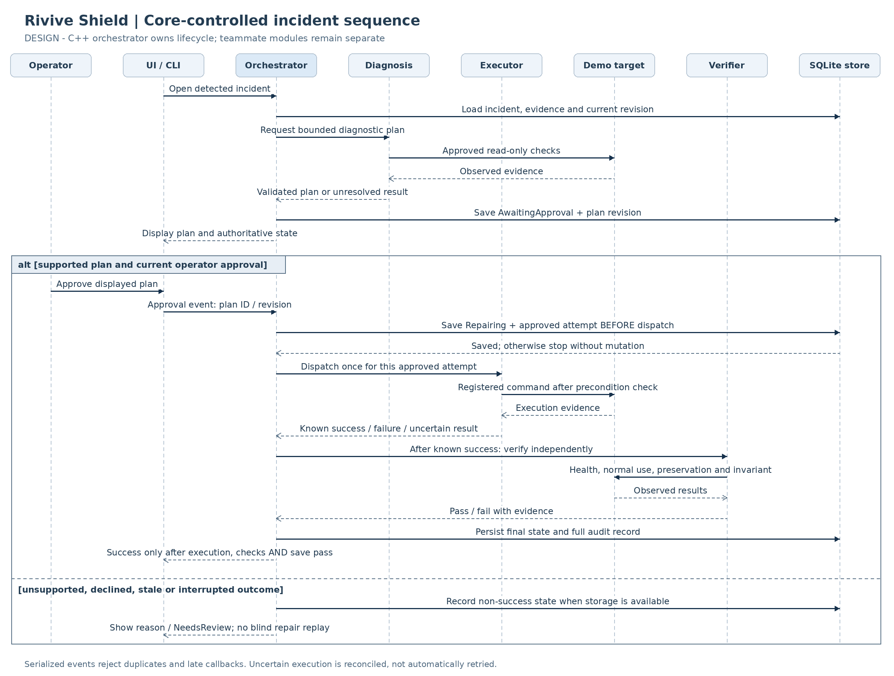
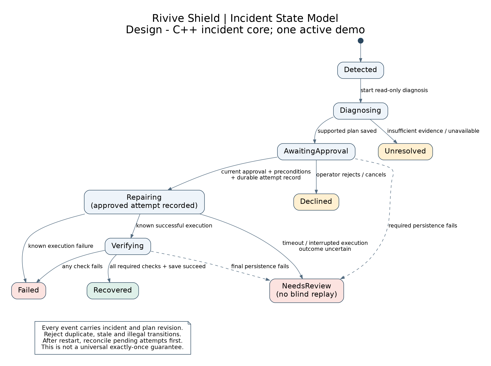

**Course:** Software Development Methods  
**Project:** Rivive Shield  
**Team leader:** Usama Shmasneh  
**Team members:** Samy mansour, Ameen Abd Allader, Shehab Shehab and Yazan Ganem

This submission defines the proposed MVP, its requirements and its system design. Implementation and evaluation are subsequent project stages; this report does not present completed test results.

**Lecturer decision:** The project is approved, as reported by team leader Usama Shmasneh. The approval date and any accompanying conditions have not been provided. This statement records approval of the project, not separate approval of every detailed design choice.

# 1. Proposal and scope

## 1.1 Problem, users and stakeholders

Rivive Shield is a proposed system for investigating and recovering supported failures in an isolated study-room booking application. The learning problem is that a visible error or service alert does not by itself show the cause, establish a safe repair or demonstrate that the repair worked.

The primary user is the **demo operator**, a student who reviews evidence and approves recovery. A **participant** uses a browser to make bookings and attempt only the allowed lab challenges. The **development team** maintains the demo and the tests. The **lecturer** evaluates the engineering process and the real end-to-end result. No paying customer or commercial business model is established; the immediate purpose is a course project and learning tool. Demonstration testers will be selected at random; their names are not yet determined.

## 1.2 Current workaround, alternatives and value hypothesis

The current-workaround hypothesis is manual inspection of service status and logs, followed by a repair and repeated checks. No interview or observed-workflow findings are included in this submission.

The alternatives include manual debugging, monitoring with a recovery checklist, and predefined automation:

- **Prometheus and Alertmanager:** Prometheus evaluates alerting rules; Alertmanager groups and manages alerts and sends notifications. This is an established alternative for detecting and communicating service problems. [Official alerting overview](https://prometheus.io/docs/alerting/latest/overview/).
- **Ansible:** playbooks define and execute configuration, deployment and orchestration procedures. This provides an established approach to predefined recovery automation. [Official playbook documentation](https://docs.ansible.com/projects/ansible/latest/playbook_guide/playbooks.html).

Rivive Shield's intended value is a small, inspectable learning workflow that connects evidence-based AI diagnosis, explicit human approval, bounded repair and independent verification for one C++ booking demonstration. This is a design focus, not a claim that existing tools cannot support broader workflows or that the project introduces a new commercial category.

**Value hypothesis:** combining detection, evidence, approval, repair and verification in one bounded workflow will make a supported incident easier for students to understand and evaluate. A short operator task should test this hypothesis rather than treating novelty or convenience as proven.

The value hypothesis will be evaluated with a short operator task and feedback on evidence clarity and ease of following the workflow. No user-study results are reported in this submission.

## 1.3 Proposed MVP

The product is Rivive Shield. The booking application is the controlled target used to demonstrate it, not a second independent product.

| Story | Intended outcome |
| --- | --- |
| US-01: Participate in a controlled challenge | A participant uses the real demo and receives a result based on a checked effect. |
| **US-02: Investigate and recover an incident, central story** | An operator reviews evidence and a bounded repair, approves it, and sees independent recovery checks. |
| US-03: Verify protection and inspect the record | The operator retests the logical fault and a variant, verifies normal use, and reads the saved incident record. |

**Proposed scope:**

- One real C++ booking application with fictitious data and a minimal browser interface.
- One controlled operational fault: stopping the designated booking service. This is fault injection, not a claim of hacking.
- One logical fault. The proposed example is acceptance of overlapping bookings for the same room and time. The proposed invariant is that two active bookings for the same room may not overlap. Time intervals are half-open, so an ending time equal to another booking's starting time is permitted. The controlled challenge creates a later conflicting booking; section 3.1 defines the proposed repair rule.
- Read-only monitoring and diagnostic tools, an AI-generated explanation and bounded repair proposal, explicit operator approval, allowlisted execution, independent verification and SQLite incident history.
- One active demonstration at a time to avoid interference between participants.

**Excluded:** arbitrary applications or faults; general cyber defense; arbitrary shell commands or SQL; unrestricted autonomous repair; live production targets; real personal or college data; device fingerprinting, device tracking or attacker identification; multiple concurrent challenge environments; guaranteed prevention of every attack. Additional scenarios belong in the future backlog and do not expand the agreed MVP automatically.

## 1.4 Goal, measurable objective and metric

**Goal:** make a supported incident understandable, recoverable and independently verifiable.

**Objective:** complete the central incident workflow from supported evidence to human-approved repair, independently verified recovery and a saved incident record. Evaluation will record the complete-trial success rate and approval-to-verification time for a predeclared set of supported trials. The machine, initial data, scenario mix and valid-trial rules will be fixed before the evaluation. Trial counts, performance targets and evaluation dates are planning decisions for that stage, not reported measurements.

**Primary metric:** complete successful trials / all scheduled valid supported trials. Keep failures in the denominator; document any invalid trial and the reason it was excluded. A successful trial requires all of the following:

1. Evidence identifies the observed failure and supports the proposed action.
2. No repair occurs before approval.
3. The service is healthy and a legitimate booking succeeds after repair.
4. Previously valid records are preserved and the chosen invariant holds.
5. The incident, approval, repair and verification results are recorded.

**Supporting measures:** detection time; approval-to-verification time; diagnostic conclusions marked supported or unresolved; and retest outcomes for the original logical case, a meaningful variant and normal use. These measures have no claimed results yet. The team must set target values before evaluating the product, rather than choosing them after seeing results.

## 1.5 AI role, constraints and risks

The AI component is designed to select approved read-only diagnostic tools, relate observations and propose a supported repair with evidence references. It must distinguish an observation, a hypothesis and an established cause. It is not given the challenge ID as the diagnosis, and it cannot execute free-form commands or database writes. Deterministic C++ code checks and executes an approved plan and independently verifies the result.

| Risk / constraint | Proposed response |
| --- | --- |
| Scope grows beyond a student MVP | Keep three stories, two scenarios and one active demo; defer additions. |
| AI explanation is incorrect or unsupported | Require evidence references; keep the cause unresolved when evidence is insufficient; refuse unsupported plans. |
| Repair damages legitimate data | Restrict target and action; validate preconditions; preserve unaffected bookings; record before/after evidence. |
| A success banner hides a failed repair | Compute success only from independent health, normal-use, invariant and persistence checks. |
| Privacy or unsafe exposure | Fictitious data, restricted demo access, no device tracking, and no secrets or real connection metadata in AI input. |
| AI or hosting access is unavailable | Verify free-access feasibility early and surface a real unavailable state; do not substitute a fake AI success. |
| Team members cannot integrate their work | Agree interfaces first, review changes and integrate small slices early. |

The intended stack is C++, SQLite and minimal browser UI. Oracle Cloud and GitHub Actions are planned, not verified project deployment. Select libraries and model/provider only after a feasibility check. Paid access is not a course requirement.

# 2. Requirements

The following acceptance criteria specify testable behavior for the proposed system. The test matrix defines the planned checks; no implementation results are reported.

## 2.1 US-01: Participate in a controlled challenge

**As a participant, I want to use the demo booking app and attempt an explicitly allowed challenge, so that I can observe a real, bounded effect.**

Acceptance criteria:

- **AC-01.1:** Given a clean baseline, when a participant creates a valid booking, the booking is stored and displayed. Synthetic names and data are used.
- **AC-01.2:** Given the authorized lab control, when the service-stop scenario is triggered, the designated booking service actually becomes unavailable; Rivive Shield's control and monitoring components remain available.
- **AC-01.3:** Given the agreed vulnerable logical scenario, a challenge succeeds only if an independent check observes the specified invariant violation. A button press or a secret input sequence alone is not proof.
- **AC-01.4:** The display distinguishes a verified challenge effect, a verified rejection by a guard, an unmet objective, and an unclassified or unresolved result. It must not label every error as an attack.
- **AC-01.5:** Only one challenge run is active at a time. Challenge controls cannot target another service or access real data.

## 2.2 US-02: Investigate and recover an incident (CENTRAL STORY)

**As the demo operator, I want to inspect an incident and its evidence, approve a supported repair plan, and see recovery verified, so that I can restore the demo without trusting an untested diagnosis.**

Acceptance criteria:

- **AC-02.1:** Monitoring creates an incident from a failed health check or an independently detected invariant violation, with timestamp, observed effect and evidence references. The diagnosis is not supplied the hidden challenge selector as its answer.
- **AC-02.2:** The diagnostic view separates observations, proposed cause and confidence or unresolved status. Every proposed repair identifies an allowlisted action, fixed demo target, relevant evidence and preconditions.
- **AC-02.3:** No state-changing repair executes before explicit operator approval of the displayed plan. Rejecting or cancelling it leaves the demo unchanged and records the decision.
- **AC-02.4:** The executor rejects unsupported actions, wrong targets, stale plans and failed preconditions. Repeated submission of the same approval must not duplicate the repair.
- **AC-02.5:** Following an approved repair, independent checks verify service health, a legitimate booking, preservation of unaffected data and the agreed invariant. Success is shown only if every required check passes and the record is saved.
- **AC-02.6:** If evidence is insufficient, the model is unavailable or any verification fails, the system shows a truthful unresolved or failed state and records the reason. It does not silently run another unapproved repair.
- **AC-02.7:** A single incident core owns lifecycle transitions and serializes incoming events for the one active demo. Duplicate approvals, concurrent callbacks and late responses cannot start a second repair, apply a stale plan or overwrite a newer outcome.
- **AC-02.8:** Before dispatching a repair, the core durably records its approved attempt and checks the current plan revision. After a timeout, interruption or restart with an uncertain execution outcome, it reconciles observations and enters NeedsReview rather than blindly replaying the action. Failed state persistence prevents new mutation and is displayed as a failure, not as a saved success.

## 2.3 US-03: Verify protection and inspect the incident record

**As the demo operator, I want to repeat the logical challenge and a variant, verify normal use and review the incident history, so that I can evaluate the targeted protection and explain the outcome.**

Acceptance criteria:

- **AC-03.1:** For the logical scenario, the approved repair activates the rule that protects the agreed invariant, rather than blocking only one exact input string or click sequence.
- **AC-03.2:** Repeating the original logical challenge and a meaningful variant does not violate the invariant. A blocked label appears only when the guard actually rejects the invalid action.
- **AC-03.3:** A legitimate booking still succeeds with the guard active. A repair that blocks all bookings does not pass.
- **AC-03.4:** The saved record includes incident times, observed effect, evidence references, supported or unresolved cause, displayed plan, operator decision, executed action and each verification result. Reloading the record shows the saved values.
- **AC-03.5:** The operational stop button remains a restricted test mechanism; its existence is not treated as a failure to prevent all future outages. Protection claims apply only to the defined logical invariant.

## 2.4 Central use case: approve and verify recovery

**Primary actor:** demo operator.  
**Supporting components:** monitoring service, diagnostic agent, repair executor, verifier and incident store.  
**Preconditions:** the isolated demo and control service are configured; a supported incident has been detected; evidence is available; no other challenge or repair is active.  
**Trigger:** the operator opens the incident.

Main flow:

1. The operator reads the observed effect and evidence.
2. The agent requests approved read-only checks and proposes a bounded diagnosis and repair.
3. The deterministic policy validates the action, target and preconditions.
4. The UI shows the exact action, expected effect, evidence and approval controls.
5. The operator approves that plan. The incident core checks the plan ID/revision and whether the current lifecycle state permits the approval.
6. The core records the approved attempt before dispatch, and the executor rechecks command preconditions before applying the allowlisted action. Duplicate or stale events cannot dispatch it again.
7. The core requests independent verification of health, a normal booking, data preservation and the invariant.
8. The core records the outcome through the store; the UI shows verified recovery only when execution, every required check and persistence succeed.

**Alternative flow A: unresolved diagnosis.** At step 2 or 3, evidence is insufficient or the plan is unsupported. No repair executes. The incident remains unresolved and lists the missing evidence or rejection reason for manual review.

**Alternative flow B: declined or failed repair.** At step 5 the operator may decline; the system records the decision without changing the target. If execution or verification fails at steps 6–7, the system records failure and stops. A different action requires a new visible plan and approval.

**Success postcondition:** the demo meets all recovery checks and an audit record is available. **Failure postcondition:** the failure is visible and recorded; no unapproved fallback or broad data deletion occurs.

## 2.5 Main-screen sketch

The sketch illustrates US-02. All displayed values are labeled example data, not collected results. The participant challenge screen will be a separate minimal view. Approval must remain distinct from diagnosis and verification.

## 2.6 Planned test traceability

| Test | Requirement | Planned check | Result |
| --- | --- | --- | --- |
| T-01 | AC-01.1 | Normal booking on clean baseline | Not run |
| T-02 | AC-01.2, AC-02.1 | Stop only demo service; monitor survives and detects it | Not run |
| T-03 | AC-01.3 | Reproduce approved logical violation and independently detect it | Not run |
| T-04 | AC-02.3 | No repair before approval; decline leaves target unchanged | Not run |
| T-05 | AC-02.4 | Wrong target, unsupported action, stale plan and duplicate approval | Not run |
| T-06 | AC-02.5 | Approved recovery; health, booking, preservation and invariant pass | Not run |
| T-07 | AC-02.6 | Unsupported evidence, unavailable AI or failed verification | Not run |
| T-08 | AC-03.1–03.3 | Original logical attempt, variant and legitimate booking after guard | Not run |
| T-09 | AC-03.4 | Reload complete incident record and compare values | Not run |
| T-10 | AC-02.7 | State-transition matrix, illegal transitions and early approval | Not run |
| T-11 | AC-02.4, AC-02.7 | Duplicate/parallel approvals, stale plan revisions and late diagnostic callbacks | Not run |
| T-12 | AC-02.6, AC-02.8 | Timeout, persistence failure and restart with uncertain action outcome; no blind replay | Not run |

# 3. System design

## 3.1 Proposed architecture and component responsibilities

The booking process is separate from the Rivive Shield control process. Stopping the booking service must not stop detection, approval or recovery. The target adapter is fixed to the owned demo, not a general remote-control tool.

| Component | Responsibility | Boundary |
| --- | --- | --- |
| Participant UI and booking service | Display rooms; create/cancel synthetic bookings; expose the agreed controlled challenge | C++ booking logic; no access to repair controls |
| Operator dashboard / CLI | Show incidents, evidence, plan, approve/reject controls and test results | Sends requests to the incident core; cannot advance lifecycle state itself |
| C++ incident orchestrator and state machine | Own lifecycle, serialize events, bind approvals to plans, dispatch modules and reconcile interrupted work | Usama's incident core; one active demo, no unrestricted automatic retries |
| Monitor and evidence collector | Check health and the chosen invariant; create evidence-linked incidents | No repair authority |
| Diagnostic agent adapter | Invoke approved read-only checks and propose a supported plan | No arbitrary shell, SQL or hidden challenge answer |
| Plan policy and repair executor | Validate the proposed action and command preconditions; execute only an authorized dispatch | No independent lifecycle controller; only registered commands on the designated demo |
| Independent verifier | Test health, legitimate use, preservation and invariant | Determines results from observations, not the agent's claim |
| SQLite repositories | Store demo data and incident/evidence/plan/approval/results | Separate logical stores; no broad reset as a repair shortcut |

### Incident orchestration and state machine

`IncidentOrchestrator` coordinates the complete incident through a dedicated `IncidentStateMachine`. Proposed normal states are Detected, Diagnosing, AwaitingApproval, Repairing, Verifying and Recovered. Explicit non-success outcomes are Unresolved, Declined, Failed and NeedsReview. Each transition checks the current incident, plan revision and triggering event. The UI displays this state rather than inventing its own success status.

The incident core has the broadest integration responsibility in the C++ design: it coordinates every module and owns ordering, lifecycle invariants and failure recovery. Its scope is one active demonstration, a serialized event queue and explicit deadlines. It is not a distributed job scheduler or an unrestricted autonomous agent.

Core deliverables assigned to Usama:

- Typed incident events and a transition table; a single authoritative state and revision per incident.
- Coordination of Ameen's detection/evidence, Shehab's diagnosis/validated-plan output, Yazan's bounded repair and independent verifier, and Usama's storage/provider adapters.
- Approval bound to the displayed plan ID and revision; duplicate, stale or out-of-order events rejected without another repair.
- Safe handling of asynchronous callbacks, cancellation before mutation and timeouts. Once a repair may have started, a cancellation or timeout must not pretend that the side effect was undone.
- A durable attempt record before dispatch and reconciliation after restart. An uncertain repair outcome enters NeedsReview; it is not automatically repeated. This is not a claim of universal exactly-once execution across crashes.
- Tests for every permitted/forbidden transition, racing approval and timeout events, stale callbacks, persistence errors and interrupted execution, plus the real end-to-end central story.

Usama owns this C++ core alongside leadership, SQLite/SQL, the external AI connection, Oracle, GitHub Actions and integration adapters. Each other member remains responsible for implementing and testing their own module.

Suggested boundary data include `Incident`, `Evidence`, `RepairPlan`, `Approval` and `VerificationResult`. A plan carries its ID, incident ID, fixed target, allowlisted action and expected state/version. This lets the executor reject a plan whose assumptions have changed.

**Proposed logical repair rule:** the controlled scenario contains an earlier valid booking and one later conflicting active booking for the same room. The approved plan identifies both records and their expected versions. It preserves the earlier booking and changes only the later conflicting booking to a non-active `cancelled_conflict` status, retaining its data and the reason in the audit record. Creation time determines order, with booking ID as the tie-breaker. A transaction rechecks the records and conflict before applying the change; a changed record, unexpected conflict set or failed precondition rejects the stale plan and requires a new diagnosis and approval. Unaffected bookings remain unchanged. Atomic validation then rejects new overlapping active bookings while allowing valid and back-to-back bookings. This is the proposed repair design; implementation and test evidence are not yet available.

## 3.2 Proposed design pattern: Command

Represent each supported state-changing repair as a concrete command behind a `RepairCommand` interface. Initial candidate commands are `RestartDemoServiceCommand` and `RestoreBookingInvariantCommand`. Each defines precondition validation, execution and the evidence it returns. `RepairExecutor` accepts only a registered command dispatched by the incident core with a current approved plan. The orchestrator owns lifecycle transitions; commands own bounded action implementation.

**Why it fits:** it keeps the AI's explanation separate from mutation, makes the small action allowlist explicit, and supports focused tests for each action. It also makes it clear which additional behavior would require a newly implemented and reviewed command. The pattern itself does not guarantee safety; policy checks, explicit approval, restricted targets and independent verification remain necessary.

Command is the selected pattern for this proposed design. Its implementation will be evaluated through the command-specific and end-to-end acceptance tests.

## 3.3 UML diagrams

The diagrams specify the proposed design. Editable source files are included in `docs/diagrams/source/`.

### Use case diagram

### Class diagram

### Sequence diagram

### Additional incident state diagram

## 3.4 Team responsibilities and coordination

The five-person team uses C++ as its shared implementation language. The planned division below gives each member a distinct C++ module. Usama also retains leadership, database, AI-service, cloud and CI responsibilities.

### Named ownership and concrete outputs

| Person | Planned responsibility | Reviewer | Required output and handoff |
| --- | --- | --- | --- |
| Usama Shmasneh | C++ incident orchestrator/state machine, plus leadership, SQLite/SQL, AI-service connection, Oracle, GitHub Actions and minimal web/API integration | Samy mansour; Yazan checks repair handoff | Core transition/event logic and T-10–T-12; working specialist adapters; build/run guide; real integrated central story |
| Samy mansour | C++ booking domain, synthetic data, reproducible logical scenario and booking-rule guard | Ameen Abd Allader | Booking operations, agreed invariant/guard and domain tests; repository interface calls only, no SQL; documented scenario and guard contract |
| Ameen Abd Allader | C++ service monitoring, evidence records, timestamps and independent invariant detection | Shehab Shehab | Monitor that survives target outage; structured evidence; detection tests including false-positive cases; documented evidence schema |
| Shehab Shehab | C++ diagnostic module, read-only tool contracts, plan-content validation and local operator CLI | Yazan Ganem | Evidence-to-plan result for Usama's core; supported/unresolved diagnosis; malformed-response tests; CLI sends approval events without owning lifecycle transitions |
| Yazan Ganem | C++ approved repair commands, independent recovery verifier and end-to-end test runner | Usama Shmasneh | Execute-once approved commands; original/variant/normal-use retests; failure handling; reproducible test runner and results template |

**Specialist boundary:** Usama implements the real SQLite repository, external AI-provider communication/authentication, deployment configuration and fixed demo-process adapter. The other members consume typed C++ interfaces and use in-memory or fake adapters in unit tests. Samy supplies the booking guard; Yazan invokes it through the agreed repair contract. Ameen supplies observations; Shehab validates and explains diagnostic plans; Yazan executes bounded commands and verifies outcomes independently; Usama's incident core controls their ordering and lifecycle. Shehab does not own a second incident state machine, and Yazan's executor does not autonomously retry or decide global success. No teammate is assigned SQL, JavaScript, cloud administration or AI-service setup as a prerequisite for their initial C++ work.

Test doubles are for development and unit tests only. They must be labeled and replaced by the real adapters for the final end-to-end demonstration; they cannot be presented as the working AI component or a successful real repair.

### Workload planning

Usama's incident core is additional to his leadership and specialist responsibilities. Capacity planning will therefore estimate core development separately from database, AI-provider, cloud and CI work. The team will first integrate the local C++ workflow, then add hosting and interface polish. Each member owns their module's tests, interface documentation, report section, demonstration preparation and defect fixes. Changes to ownership will be agreed explicitly when reviewing sprint capacity.

### Define, Verify and Integrate

**Define:** Usama coordinates scope and acceptance with all five members. Each owner writes the inputs, outputs and acceptance checks for their module. **Verify:** Yazan coordinates the end-to-end test list; every owner runs module tests and the named reviewer checks the results. Ameen independently reviews booking/invariant behavior. **Integrate:** Usama implements the central C++ incident core and coordinates the shared interfaces and specialist adapters; each owner supplies a runnable C++ module and resolves their own defects. Integration ownership does not make Usama responsible for rewriting unfinished teammate modules.

The review rotation is Samy reviews Usama; Ameen reviews Samy; Shehab reviews Ameen; Yazan reviews Shehab; Usama reviews Yazan. For Usama's specialist changes, Samy can follow documented setup steps and inspect observable behavior against requirements, while unfamiliar SQL/cloud/security configuration is explicitly flagged rather than claimed to have received expert review. Usama must provide focused tests and specialist checks. The lead's work still receives teammate review.

**Coordination method:** agree interfaces and the active sprint goal before splitting work; track owner, priority, state, dependencies and a rough effort estimate on the selected Trello backlog board; raise blockers during sprint coordination; and review changes through pull requests with short notes stating what was checked, found and changed. Human review and required tests precede merging.

## 3.5 Incremental plan and contribution evidence

1. Agree the users, exact logical invariant, three stories, targets, named ownership and lecturer feedback.
2. Implement Usama's incident state machine and module contracts, then build the thin local slice: legitimate booking, stop the demo, detect independently, approve restart, verify a booking, persist the record.
3. Connect the bounded AI diagnosis to that slice and test supported and unresolved cases.
4. Add the agreed logical fault, bounded repair and guard; retest original and variant attempts plus normal use.
5. Integrate the UI, run the declared evaluation, prepare evidence and then validate hosting if feasible within scope.

Sprint notes will record the goal, completed work and next adjustment. Commits, pull requests and reviews will be linked to backlog items as development proceeds. Personal research topics will be selected separately from the course list and will differ across the five members.

## 3.6 AI-use disclosure and source traceability

AI assistance was used to prepare and refine the report, planning documents and diagrams. The team is responsible for checking the resulting claims, requirements and sources.

**Planned tools:** Usama Shmasneh will use ChatGPT; other members will use a mix of ChatGPT, Gemini and Claude. Specific model versions and member-to-tool assignments are not provided. This plan does not identify past tool use or the application's runtime AI provider.

**Actual-use and review record:** TODO: document each tool/model version, its actual use, reviewer(s) and corrections. A completed human-review record has not been provided.

Course sources used:

- `1-rolling_assignment_course_project_en_v19.docx`: pages 2–3, Markdown, README, backlog and stage requirements; page 6, the three-section first-submission rubric; pages 4–5 and 8, implementation, individual work and AI-use rules.
- `SDM_Initiation_proposal_v21.pdf`: pages 14–17 and 27–28, goal/objective/metric and the proposal's open questions.
- `SDM_Teamwork_part2_en_v10.pdf`: pages 5–9, Define/Verify/Integrate ownership, coordination, review and integration.
- Earlier `REVIVE_Shield_Project_Proposal_HE.docx`, dated 28 October 2026: project concept and safety boundaries. The present design develops that concept; the actual lecturer decision is recorded separately.
