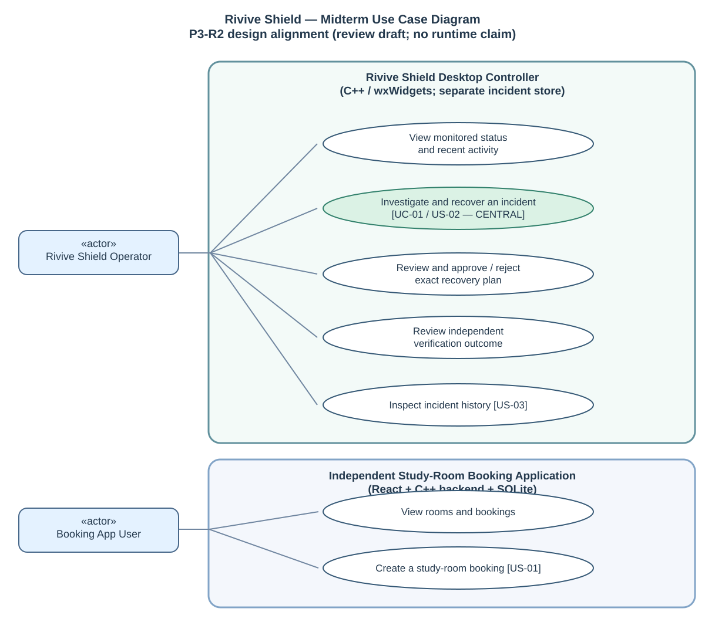

# Rivive Shield — Midterm Requirements and Use Case (Review Draft v2)

**Author of this midterm draft:** Samy Mansour  
**Status:** Draft for Samy's manual review, Yazan's sequence/acceptance alignment, Rawaa's report integration and final owner review. **Not an approved GitHub commit, completed software or executed test.**  
**Design baseline:** [merged P3 contract](https://github.com/1UsamaShmasneh1/Rivive_Shield/commit/2f9267f23a058f3a6f6cdd29d240e6adf65129da) at full commit `2f9267f23a058f3a6f6cdd29d240e6adf65129da`. **This SHA identifies the source design, not a Midterm-deliverable commit.**  
**Live backlog:** [Rivive Shield Trello](https://trello.com/b/GeLevegk/riviveshield) — titles/priorities require separate live-board audit.  
**Diagram source:** [`Samy_Midterm_UseCase_P3R2.dot`](Samy_Midterm_UseCase_P3R2.dot)  
**Diagram image (SVG for GitHub preview):** [`Samy_Midterm_UseCase_P3R2.svg`](Samy_Midterm_UseCase_P3R2.svg)

## Scope and actors

Rivive Shield is an educational, locally bounded monitoring and recovery system for a **separate** study-room booking application. The booking application consists of a React browser interface, a C++ booking backend and its own SQLite database. The C++/wxWidgets desktop controller collects bounded metadata, evaluates supported conditions using **predefined rules (no runtime AI model in the first version)**, displays an exact recovery plan for **explicit operator approval**, and independently verifies supported outcomes. Incident storage is separate from booking storage. This is a design description, not proof of a working integrated product.

- **Booking App User:** creates and views bookings in the separate application using fictitious data.
- **Rivive Shield Operator:** monitors the configured target, inspects evidence and incident records, and approves or rejects bounded actions.

Out of scope: arbitrary remote/production targets, arbitrary commands/SQL, runtime AI-driven action execution, deleting or cancelling bookings, automatic repair without approval, and treating an uncertain observation as successful recovery.

## Stable-ID user stories

### US-01 — Create a Study-Room Booking

**As a** booking application user, **I want** to view study rooms and submit a booking request, **so that** I can reserve a room for a selected time interval.

**Design-level acceptance criteria (planned, not executed):**
1. The UI can request the room list and booking list from the independent backend.
2. A valid reservation is stored with UTC timestamps; `startsAt` precedes `endsAt`.
3. Same-room overlapping intervals are rejected; adjacent half-open intervals are permitted.
4. An identical request-ID retry cannot create a second booking, while changed details using the same ID are rejected.
5. Missing/invalid requests and storage uncertainty are reported accurately; a successful booking is not assumed after an unconfirmed write.

**Trace:** P3 `docs/BOOKING_HTTP_CONTRACT.md` (GET `/api/rooms`, GET `/api/bookings`, POST `/api/bookings`).

### US-02 — Investigate and Recover an Incident **(CENTRAL STORY)**

**As a** Rivive Shield operator, **I want** to inspect incident evidence, review and explicitly approve or reject a bounded recovery plan, and inspect independently verified results, **so that** I can respond safely to supported failures without unauthorized or unverified changes.

**Design-level acceptance criteria (planned, not executed):**
1. An incident is based on supported monitored evidence; insufficient evidence remains inconclusive rather than creating a guessed diagnosis.
2. The operator sees the exact current plan, approved target, evidence and preconditions before deciding.
3. Reject or absence of approval causes no process-changing action. Stale/mismatched plans are rejected.
4. One confirmed durable dispatch claim is required before an approved action can execute; duplicate/uncertain claims never authorize replay.
5. Force-stop (where applicable) requires its own approval; a confirmed stop leads to `NeedsReview`, followed by stopped-writer database checks, a **new** start plan and a **fresh** approval before restarting.
6. `Recovered` is reported only after required independent process, prior database and functional checks and confirmed incident persistence; uncertain/in-flight work blocks closure.

**Trace:** P3 `docs/BEHAVIOR_AND_GATES.md`, `schemas/state_policy_proposed.json`, `schemas/incident_proposed.sql` and `docs/TERMINATION_REPOSITORY_MAPPING.md`.

**Why central:** This is Rivive Shield's distinctive operator-facing value: evidence → exact human decision → bounded action → independent verification → durable record. It does not conflate the separate booking user with the desktop operator.

### US-03 — Inspect Application Status and Incident History

**As a** Rivive Shield operator, **I want** to view the configured application's status, recent metadata-only activity, current incident and saved history, **so that** I can understand the evidence, approval decisions and verified or unresolved outcomes.

**Design-level acceptance criteria (planned, not executed):**
1. The desktop interface covers application status, recent activity, incident/approval details and history.
2. Activity evidence is bounded/sanitized; raw HTTP request bodies are not persisted.
3. An unsuccessful, pending or uncertain outcome is not displayed as successful recovery.
4. Incident history reflects recorded approvals, attempts, termination records (when applicable) and verification evidence; unavailable/inconsistent storage is reported as uncertainty, not success.

**Trace:** P3 `docs/EXACT_CATALOG.md` (`WxDesktopView` four panels; `OperatorView`), `contracts/p3_draft.hpp` and `docs/BEHAVIOR_AND_GATES.md`.

## Worked Use Case: UC-01 — Investigate and Recover a Supported Booking-Service Incident

**Related story:** US-02 (central).  
**Primary actor:** Rivive Shield Operator.  
**System boundary:** Rivive Shield Desktop Controller; the booking service is a separate configured target.  
**Goal:** Safely restart an **already stopped/exited**, owned booking service and record an independently verified recovery.  
**Trigger:** Operator opens a supported incident for the stopped configured booking service.  
**Preconditions:** Target is explicitly configured and owned; incident and evidence are available; process state is sufficiently established; no conflicting in-flight action or unresolved effect; sufficient database preconditions for a start plan can be verified; storage is available.

### Main flow — start an already stopped, owned service

1. The operator opens the active incident and sees the monitored target, observed process condition, and supporting evidence.
2. The controller applies **predefined** diagnostic rules and distinguishes the supported failure from uncertain or insufficient evidence.
3. Where required, it verifies the configured booking SQLite database read-only **after writers are confirmed stopped** and ties that result to the stopped process generation.
4. The controller prepares a bounded **start** plan for the exact configured owned target and makes its evidence, scope, and preconditions visible.
5. The operator reviews and explicitly **approves** that exact current start plan.
6. The policy validates the exact plan, current state, approval, target binding and absence of competing work. The SQLite incident repository must durably claim the attempt and record the transition to `Executing` before any external process-changing call.
7. The authorized executor starts the intended owned process (if the claim and preconditions are confirmed). It does not replay after uncertainty.
8. The controller records the observed execution outcome and enters verification according to the reviewed state policy.
9. The verifier independently checks the new process generation, required prior database conditions and functional booking behavior; it does not infer success from exit code alone or from a single HTTP response.
10. Only after every required check passes and storage commit is confirmed does the controller show `Recovered` and make the outcome available in incident history.

### Alternative A — operator declines at step 5

A1. The operator selects **Reject** for the displayed plan. No process-changing action is dispatched.  
A2. Only when the exact current plan and **all** durable closure guards permit it may the incident be committed as `Declined`.  
A3. If an unclaimed, unterminated `Prepared` attempt, unresolved effect, or unconfirmed closure write blocks closure, leave the incident open and preserve the prior durable state. Reject alone must not terminate that attempt; a separately authorized termination followed by a **new** closure evaluation is required where applicable.

### Alternative B — insufficient evidence, failure or uncertainty (steps 2, 3, 6–10)

B1. No valid plan, uncertain process/ownership, blocked claim, unavailable storage, or inadequate verification prevents claiming success.  
B2. Preserve the true durable state and record/report uncertainty or required review according to the approved policy; do not dispatch or replay an action whose durable outcome is unconfirmed.  
B3. No success label or incident closure until the required guards and confirmations are met.

### Alternative C — service needs a force-stop first (before step 3)

C1. An explicitly requested force-stop must be presented as its own exact plan and explicitly approved.  
C2. A confirmed stop leads to `NeedsReview`, **not** `Recovered`.  
C3. Confirm writers are stopped, then verify the configured booking database read-only. A sufficient result permits **preparing** a new start plan, not executing it.  
C4. Obtain a **new explicit approval** for the start plan, then resume from the guarded claim at step 6. Unconfirmed stop, database check or ownership remains unresolved; no automatic restart.

**Success postcondition:** Required health/database/function checks pass for the authorized target and a durable recovered incident record exists.  
**Non-success postcondition:** No unapproved action or misleading recovery result; incident state and history reflect only confirmed persistence.

## Diagram (user goals, not execution sequencing)

The original PNG draft is attached to [Samy's Midterm Trello card](https://trello.com/c/Dml40dua). This review branch includes an SVG preview and the editable DOT source. The PNG attachment remains available on Trello for comparison.

The image depicts actor goals in **two separate system boundaries**. It intentionally does **not** depict step order, class relationships, fictitious extra use cases, or unreviewed `<<include>>`/`<<extend>>` relationships. Step order and alternatives are documented in UC-01 above and must be aligned with Yazan's sequence diagram before acceptance.

## Traceability and pending verification

| Item | Primary reference | Output | Evidence status / reviewer |
| --- | --- | --- | --- |
| Stable stories, central US-02 | `2f9267f`: booking HTTP, behavior/gates, exact catalog | US-01/02/03 above | Draft; Samy manual review pending |
| Worked Use Case, branches | `2f9267f`: behavior/gates, state policy, termination mapping | UC-01 main + A/B/C | Draft; Yazan sequence/acceptance alignment pending |
| Matching editable diagram | UC-01 and `2f9267f` system boundary | `.dot` + `.png` | Draft; Samy and independent team review pending |
| RS-05 scenarios | RS-05 Scenario Specifications Review v2 (17 pages; historical evidence, not product acceptance) | Seven bounded scenarios and their expected classifications | Document-level alignment checked; no integrated execution claim; independent team review of the midterm wording still required |
| Backlog titles/priorities | [Live Trello board](https://trello.com/b/GeLevegk/riviveshield) and [`docs/backlog-seed.md`](https://github.com/1UsamaShmasneh1/Rivive_Shield/blob/main/docs/backlog-seed.md) | Link above | 30/31 Trello task titles matched available board screenshots; RS-22 wording differs (Windows x64 vs cross-platform). Trello priority values still unverified; owner/Rawaa confirmation pending |
| Report integration | Final reviewed artifact URLs + approved commit (not yet available) | Send to Rawaa | **Pending:** Yazan's sequence/test alignment, Samy's human sign-off, owner review, and the **separate** Midterm artifact commit; P3 source SHA is not this deliverable's SHA |
| AI-use disclosure | ChatGPT assisted draft text and Graphviz source/diagram | Share with Shehab | Human check of outputs required; no test run claimed |

## Verified, commit-pinned design references

**Authoritative source commit:** [`2f9267f23a058f3a6f6cdd29d240e6adf65129da`](https://github.com/1UsamaShmasneh1/Rivive_Shield/commit/2f9267f23a058f3a6f6cdd29d240e6adf65129da) (P3 contract). This is not the future commit for Samy’s Midterm files.

- [Booking HTTP contract](https://github.com/1UsamaShmasneh1/Rivive_Shield/blob/2f9267f23a058f3a6f6cdd29d240e6adf65129da/docs/design-proposals/Rivive_Shield_UML_Proposal_P3/docs/BOOKING_HTTP_CONTRACT.md) — `2f9267f23a058f3a6f6cdd29d240e6adf65129da`
- [Behavior and execution gates](https://github.com/1UsamaShmasneh1/Rivive_Shield/blob/2f9267f23a058f3a6f6cdd29d240e6adf65129da/docs/design-proposals/Rivive_Shield_UML_Proposal_P3/docs/BEHAVIOR_AND_GATES.md) — `2f9267f23a058f3a6f6cdd29d240e6adf65129da`
- [Exact catalog](https://github.com/1UsamaShmasneh1/Rivive_Shield/blob/2f9267f23a058f3a6f6cdd29d240e6adf65129da/docs/design-proposals/Rivive_Shield_UML_Proposal_P3/docs/EXACT_CATALOG.md) — `2f9267f23a058f3a6f6cdd29d240e6adf65129da`
- [State policy](https://github.com/1UsamaShmasneh1/Rivive_Shield/blob/2f9267f23a058f3a6f6cdd29d240e6adf65129da/docs/design-proposals/Rivive_Shield_UML_Proposal_P3/schemas/state_policy_proposed.json) — `2f9267f23a058f3a6f6cdd29d240e6adf65129da`
- [Prepared-attempt termination repository mapping](https://github.com/1UsamaShmasneh1/Rivive_Shield/blob/2f9267f23a058f3a6f6cdd29d240e6adf65129da/docs/design-proposals/Rivive_Shield_UML_Proposal_P3/docs/TERMINATION_REPOSITORY_MAPPING.md) — `2f9267f23a058f3a6f6cdd29d240e6adf65129da`

**Midterm artifact commit:** Not created/approved yet. Update this line with the separate full 40-character commit SHA and its direct GitHub link after reviewer alignment and publication.

**Known coordination blockers:** RS-22 title/scope difference and live Trello priority values need confirmation; Yazan must check UC-01 against his sequence/acceptance cases; Rawaa will integrate only the final reviewed version.

**Do not mark Trello checklist items complete or move card to Ready until the content, links, reviewer alignment and requested evidence are checked.**